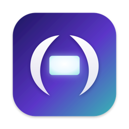
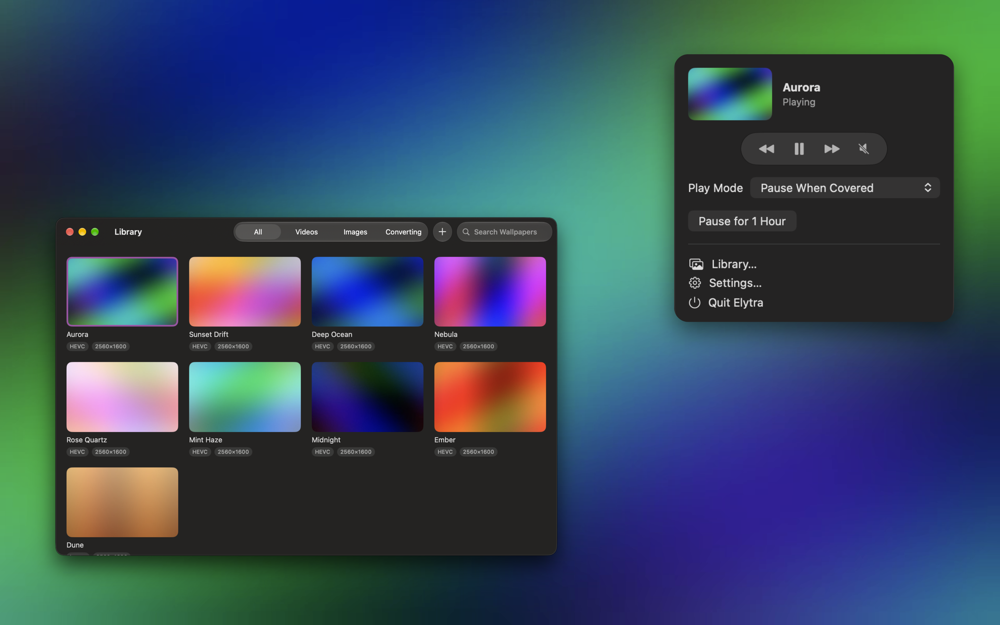
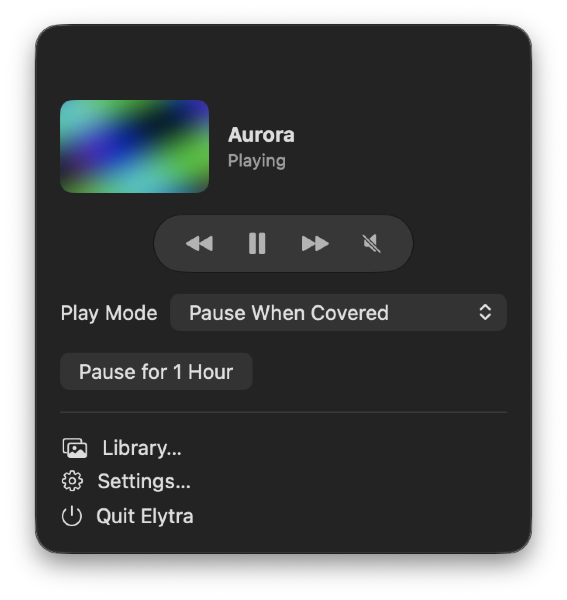
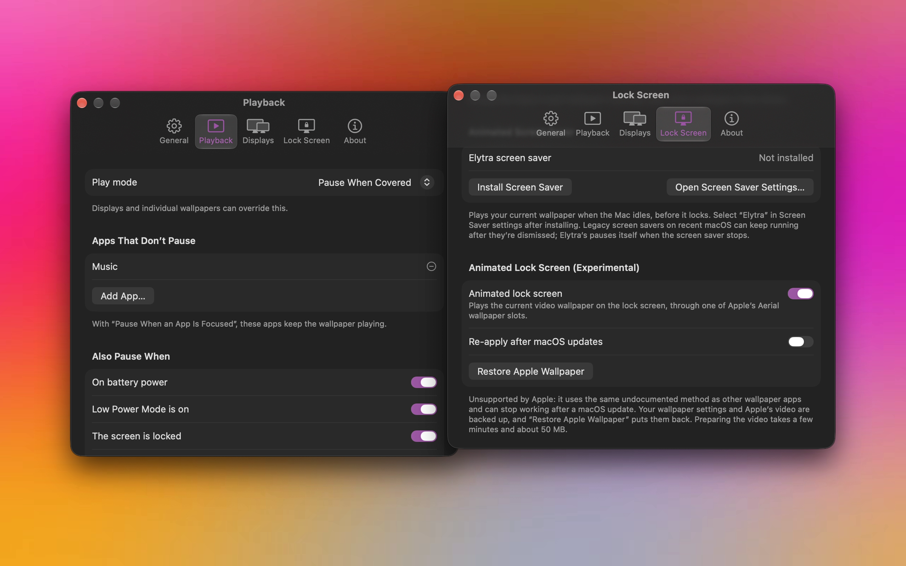
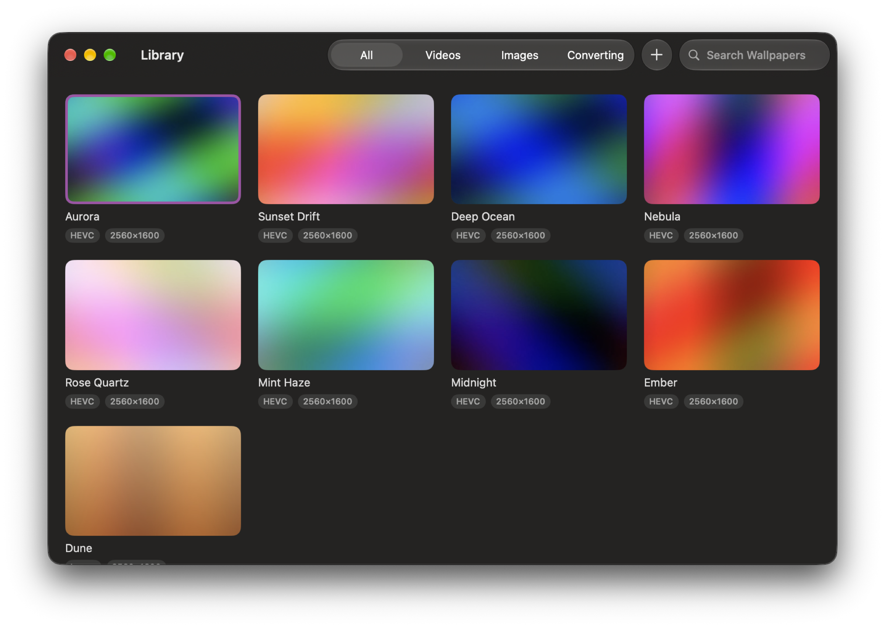

  

<h1 align="center">Elytra</h1>

<b>Live wallpapers for your Mac, without the battery tax.</b> 
A native macOS menu-bar app that plays video wallpapers behind your desktop icons, and stays out of the way when you can't see them.

  <a href="../../releases/latest"><b>Download for macOS ▸</b></a>

## Why Elytra

- **Uses almost no power.** Playback uses the Mac's hardware media engine. It pauses itself when windows cover the desktop, on battery, in Low Power Mode, under thermal pressure or when the screen locks, and after five minutes paused it unloads the video completely. **0% CPU when paused · about 2% while playing 4K.**
- **Native and light.** SwiftUI and AVFoundation, Liquid Glass from the system itself. No Electron, no web views, no background services. The whole app is under 25 MB.
- **Plays almost anything.** Drop in MP4, MOV, WebM, MKV, AVI, GIF, animated WebP and more. Anything the Mac can't hardware-decode is converted once, on import, to efficient HEVC.
- **You stay in control.** Pick when wallpapers play, per display and per wallpaper, with global shortcuts for pause and next.

## Features

**Playback**
- Seamless loops, with trim points, speed (¼×–2×), Fill / Fit / Stretch / Center, dimming, optional sound
- Play modes: *Always*, *Pause when an app is focused* (with an allow-list), *Pause when covered*, *Pause in full-screen apps*, *Manual*
- Extra pause rules: battery, Low Power Mode, screen locked, screen sharing, high thermal pressure
- Respects Reduce Motion (shows a still frame)
- Pause / Resume, Next / Previous, Mute, *Pause for 1 Hour*
- Global keyboard shortcuts you choose (⌃⌥⌘P, ⌃⌥⌘N by default)

**Displays**
- Same wallpaper everywhere (decoded once and shared) or a different one on each display
- Handles monitors being plugged and unplugged automatically

**Library**
- Drag and drop files or whole folders, then search and filter
- Codec and resolution badges, plus a one-click **Convert to HEVC** for files that waste power
- Still images (JPG, PNG, HEIC) as a zero-cost option

**Lock screen and screen saver**
- **Animated lock screen (experimental):** your video plays on the Mac's lock screen, even when Elytra is closed. One click to turn it on, one click to restore Apple's wallpaper
- Or keep it simple: the wallpaper's still frame (you pick the frame) becomes your lock screen, login and Mission Control background
- Optional bundled screen saver that plays your current wallpaper when the Mac is idle
- Your original wallpaper comes back when you quit

  

## Supported formats

| You drop in | Elytra does |
|---|---|
| MP4 · MOV · M4V (H.264, HEVC, HEVC with alpha, ProRes, AV1*) | Plays directly with the hardware decoder |
| WebM (VP8/VP9/AV1) · MKV · AVI · FLV · WMV · MPG · TS/M2TS · 3GP · OGV | Converts once to HEVC, or remuxes losslessly when possible |
| Animated GIF · WebP · APNG | Converts once to HEVC |
| JPG · PNG · HEIC | Static wallpaper |

\*AV1 plays natively on Macs with AV1 hardware decoding (M3 and later).

## Install

1. Download **Elytra-x.y.z.dmg** from [Releases](../../releases/latest).
2. Open it and drag **Elytra** into **Applications**.
3. Launch Elytra. It lives in the menu bar and has no Dock icon.
4. Click the menu bar icon, choose **Library…**, and drop in a video.

> This build is not notarised. If macOS says it can't verify the developer, right-click **Elytra** in Applications, choose **Open**, then **Open** again. You only need to do this once.

**Requirements:** macOS 26 Tahoe or later, Apple silicon.

## Tips for the best wallpapers

- **HEVC** at your screen's resolution is the most efficient format.
- Short loops (10–30 seconds) at 24–30 fps look smooth and cost little.
- If your menu bar is crowded, the notch can hide the Elytra icon. Open Elytra again from Finder or Spotlight to get to Settings.

## Privacy

Elytra has no network code and no analytics. Your wallpapers stay in `~/Library/Application Support/Elytra`.

## FAQ

**Can Elytra animate the lock screen?**
Yes, as an experimental option. macOS has no official API for this, so Elytra uses the same approach as other wallpaper apps: it re-encodes your video once (about 2 minutes) into the format of Apple's Aerial wallpapers and swaps it into one Aerial slot. A macOS update can undo it; turn on **Re-apply after macOS updates** if you want Elytra to put it back automatically. **Restore Apple Wallpaper** reverts everything.

**Does it slow down games or video calls?**
With the default *Pause when covered* mode, a full-screen or maximised window pauses the wallpaper, and after five minutes the video is unloaded from memory entirely.

## Acknowledgements

Elytra includes [FFmpeg](https://ffmpeg.org) 8.0, used only to convert imported videos. It is licensed under the [GNU LGPL v2.1 or later](https://www.gnu.org/licenses/old-licenses/lgpl-2.1.html) and built without GPL or non-free components (`--disable-autodetect --enable-videotoolbox --enable-audiotoolbox --enable-zlib --enable-bzlib`) from the [official source](https://ffmpeg.org/releases/ffmpeg-8.0.tar.xz). It ships as a separate, replaceable executable at `Elytra.app/Contents/Helpers/ffmpeg`.

---

© 2026 hrxshxx. All rights reserved.
